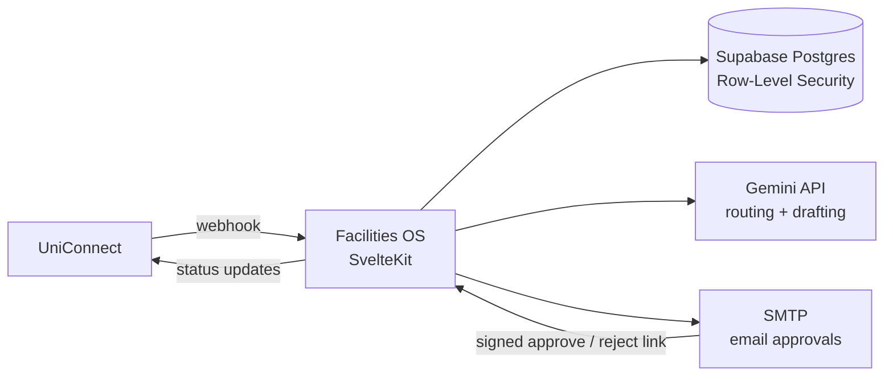

# Facilities OS

**A requirement-to-fulfilment platform for university facilities and events.**

## The problem

Facility and event needs (furniture, branding, stationery, AV, catering) were raised over calls, spreadsheets and email threads. There was no approval trail, no vendor history and no visibility into budgets, so the same questions came up for every request: who approved it, which vendor did we use last time, and how much have we spent?

## What it does

A request moves through one tracked pipeline from raise to delivery, across multiple universities:

1. **Raise.** Staff raise a request in the app, or it arrives automatically from **UniConnect** via a signed webhook.
2. **Scope.** Line items and an itemised budget are attached.
3. **Approve.** L1, then L2 approval by email, using one-click links signed with HMAC and set to expire. Pending approvals trigger reminders.
4. **Source.** The request is matched to a vendor from a directory of **114+ vendors with reviews**, and an RFQ goes out.
5. **Deliver.** It is tracked through confirmation, production, transit and delivery.

Every step records status updates, comments and attachments in a **full audit log**, and the requester is emailed on each change.

### AI

- **Gemini auto-allocation** routes each request to the right owner and shortlists suitable vendors.
- **Gemini email drafting** writes detailed vendor RFQs from the request's line items.
- **Document analysis** extracts line items from uploaded quotes and bills.

## Architecture



## Stack

| Layer | Choice |
|---|---|
| App | SvelteKit (Svelte 5), TypeScript, `adapter-node` |
| Data and auth | Supabase (Postgres, Auth, Storage, Realtime, RLS) |
| AI | Google Gemini API |
| Email | SMTP via Nodemailer |
| Hosting | Railway (Nixpacks) |

## Why these choices

- **SvelteKit:** a single codebase for UI, server routes and webhooks, with very little boilerplate. That kept a one-person build fast.
- **Supabase:** Postgres with row-level security, auth, file storage and realtime built in, so there was no separate backend to run.
- **Gemini:** it handles both structured routing and long-form drafting, at a cost that suits high-volume internal use.
- **Email-based approvals:** approvers act from their inbox with no login, so approvals actually happen. Links are signed and expire.

## Running locally

```bash
cp .env.example .env     # fill in your own Supabase, Gemini and SMTP values
npm install
npm run dev
```

Create the database schema by running `supabase/schema.sql` in your Supabase project. Every environment variable the app reads is listed in `.env.example`.

---

Built by **Karthikeya Alla**, creator and product owner.
